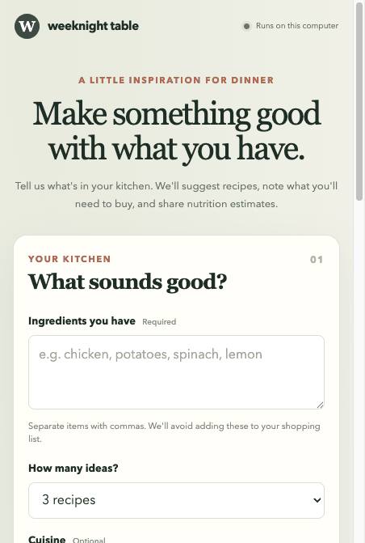

<div align="center">

# 03 — Recipe Generator


A multi-turn AI tool that generates recipes from available ingredients, then builds a shopping list and nutrition summary from the same conversation. Includes an evaluation harness to measure recipe quality, constraint handling, and safety — exploring context management, dynamic cost control, and responsible AI product iteration.

</div>

---

## Web app preview



This walkthrough uses a mocked sample response to demonstrate the UI; it does not represent a live OpenAI generation.

## Why this project

This project moves beyond a single-shot prompt into a genuine multi-turn conversation, and explores how to evaluate AI product quality—not just build the experience. It treats real product problems as first-class design decisions and uses an eval harness to turn expectations around recipe usefulness, constraints, and safety into measurable checks:

| Technical concept | Product framing |
|---|---|
| Multi-turn `messages` history | Shopping list and nutrition summary are generated *from* the recipes already in context — no redundant re-pasting of content, no wasted tokens |
| Dynamic `max_tokens` scaling | Token budget scales with `no_recipes` rather than a fixed guess — calibrated against real `usage` data instead of trial and error |
| Constraint transparency | The model is explicitly instructed to flag when a recipe can't fully meet a time or cuisine constraint, rather than silently drifting or hallucinating a fit |
| Nutrition framing | Nutrition output is explicitly scoped as general/informational, not personalized dietary advice |
| Agent evaluations | Deterministic checks and an LLM judge assess generated recipes against product expectations, making gaps visible and future iterations comparable |

## What it does

An interactive local browser app, with an optional terminal mode, that:
- Takes ingredients on hand, up to 5 recipes, dietary preferences, a time/difficulty constraint, and an optional cuisine preference
- Collects allergies separately from dietary preferences and instructs the model to treat stated allergens as exclusions
- Displays and saves a reminder that recipes are not guaranteed allergen-safe; users must verify product labels and cross-contact risk
- Validates the recipe count and required text inputs
- Generates recipes matching those constraints, explicitly noting any it couldn't fully satisfy
- Lets users replace an individual recipe with a different idea while avoiding all recipes previously generated in the current run
- Follows up in the same conversation to generate a shopping list, excluding ingredients already on hand
- Follows up again to add a general nutritional estimate per recipe
- Performs a separate constraint verification pass
- Supports repeated runs; terminal mode can be exited with `quit` or `n`
- Saves each successful run as Markdown and JSON in `generated/`
- Shows total token usage in the browser and logs usage per call in the terminal

## Setup

```bash
pip install -r requirements.txt
```

Create a `.env` file in this folder with:
OPENAI_API_KEY=your_key_here


Run the browser interface (the default):
```bash
python3 app-recipe.py
```
It automatically opens [http://127.0.0.1:8000](http://127.0.0.1:8000) in your browser. Keep the terminal window open while using the app; press `Ctrl+C` there to stop the local server.

To open the browser interface explicitly:
```bash
python3 app-recipe.py --web
```

Run the terminal-based version with:
```bash
python3 app-recipe.py --cli
```
The web app binds to your own computer only. Each successful run is saved under `generated/` as JSON and Markdown, and you can also download the Markdown from the page.

## Agent evaluations

The recipe agent is evaluated against realistic ingredient, dietary, allergy, safety, and constraint scenarios using deterministic checks and an LLM judge. The harness records model and run metadata so results can be reviewed and compared across iterations. See the [evaluation README](./evals/README.md) for the methodology, setup, initial live results, and known limitations.

## Tech stack

- Python 3.14
- Flask local web server
- OpenAI Python SDK
- python-dotenv (environment variable management)

## What I'd build next

- Add unit tests for input validation and response formatting
- Support swapping or substituting ingredients interactively
- Add an explicit refusal/clarification path for non-food or unsafe inputs, and evaluate it with the existing decline scenario
- Improve poultry food-safety guidance and add tests to ensure recipes include safe internal cooking temperatures